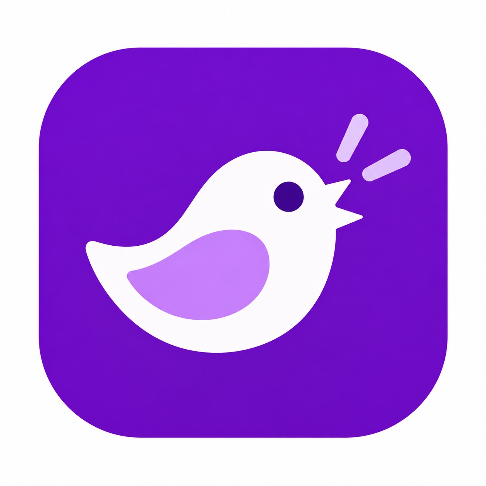

<div align="center">
  
  <h1>Ping</h1>
  <p><strong>Informações esportivas mais fáceis de encontrar e compartilhar.</strong></p>
  <p>Aplicativo Android para atletas, técnicos e organizadores de eventos esportivos.</p>
</div>

---

## Por que o Ping?

Em um evento esportivo, uma mudança de horário ou local precisa chegar a quem participa.
Quando os dados ficam espalhados em panfletos e vários grupos de mensagens, é fácil perder
uma atualização — e a conexão instável pode dificultar ainda mais o acesso.

O **Ping** explora uma forma de reunir as informações do evento e facilitar sua consulta.
O projeto é um protótipo Android com foco em eventos multiesportivos.

## O que o aplicativo oferece

| Perfil | Recursos |
| --- | --- |
| **Atleta** | Consultar partidas, agenda, locais e alojamentos, avisos e boletins; encontrar e entrar em equipes. |
| **Técnico** | Usar os recursos dos atletas, criar e gerenciar a própria equipe e publicar informações para ela. |
| **Organização** | Administrar informações do evento e publicar avisos gerais, inclusive comunicados de emergência. |

Outros recursos do protótipo:

- Boletins com PDF, imagens ou links.
- Notificações Android para novas informações.
- Consulta a conteúdo já sincronizado e salvo no aparelho.
- Tentativa de troca de avisos entre aparelhos próximos com Google Nearby Connections.
- Interface em português e tutorial para o primeiro acesso.

## Conectividade: o que esperar

O Ping foi pensado para cenários de conectividade limitada, mas **não garante entrega de
avisos sem internet**. A consulta offline depende de informações previamente sincronizadas.
O Nearby precisa de preparação inicial, aparelhos compatíveis, permissões, Bluetooth e Wi-Fi
ligados e o app aberto. Os anexos precisam ser baixados do servidor; não são enviados pelo
Nearby.

O servidor Python incluído **não está hospedado**. A versão do repositório é um protótipo
de demonstração — não um sistema certificado para emergências. Leia
[VALIDACAO.md](VALIDACAO.md) para ver o que foi verificado e o que ainda não foi testado
em aparelhos físicos.

## Prévia e documentação

- [Guia de instalação e demonstração](GUIA.md)
- [Relatório de validação e limitações](VALIDACAO.md)
- [Arquivo da prévia visual](PREVIA-PING.html) — baixe o repositório e abra o arquivo no navegador; a página de arquivos do GitHub não executa a demonstração.

## Começar

### Preparar o servidor

Requer Python 3 e conexão com a internet para instalar a dependência:

```sh
cd server
python3 -m venv .venv
source .venv/bin/activate
python -m pip install -r requirements.txt
python server.py --setup
```

Na primeira execução, crie a conta da organização com uma senha própria. Não há senha
padrão. Mantenha o mesmo banco e a chave de autoridade para preservar as contas e a
confiança dos aparelhos.

Para conectar um celular físico ao servidor de demonstração, configure no app o endereço IP
do computador na rede local, por exemplo `http://192.168.1.20:8787`. No celular, `localhost`
aponta para o próprio celular, não para o computador.

### Compilar o aplicativo Android

Requer JDK 17 e Android SDK 35. Na pasta deste projeto:

```sh
./gradlew assembleDebug
```

O APK de depuração será criado em `app/build/outputs/apk/debug/app-debug.apk`.
O identificador Android é `br.com.eventoperto`; a versão atual do projeto é 0.5.

## Estrutura do projeto

```text
app/       Aplicativo Android em Kotlin e interface local em HTML/CSS/JavaScript
server/    API Python, autenticação, equipes, avisos e anexos
GUIA.md    Instruções detalhadas para instalação e demonstração
VALIDACAO.md
           Verificações executadas e itens que exigem teste em aparelhos reais
```

## Segurança e dados

Não inclua neste repositório bancos de dados, senhas, tokens, chaves privadas ou dados reais
de participantes. O `.gitignore` exclui os bancos locais, certificados privados, arquivos de
ambiente e builds. A chave `evento.sqlite3.authority.pem` e o banco do servidor pertencem a
cada instalação e devem ser guardados em backup seguro — nunca enviados ao GitHub.

O app pode ser usado por menores de idade. Antes de qualquer uso real, a organização
responsável deve definir o tratamento dos dados, as permissões e os avisos de privacidade.

## Proposta de acesso

A proposta do projeto é manter o acesso gratuito para atletas e buscar financiamento junto
a organizadores ou patrocinadores. Esse modelo ainda precisa ser validado com eventos reais.

## Licença

Este repositório ainda não inclui um arquivo de licença. A publicação pública do código,
por si só, não concede permissão de reutilização ou redistribuição.
